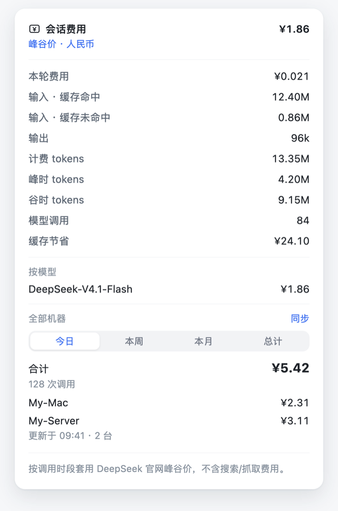

# dsh-billing

[](LICENSE)


在 DeepSeek Harness 输入框下方实时显示本会话的费用。默认按 **峰谷时段** 计价，也可以切换成 **全部峰时**；需要时还能通过 SSH 把多台机器的用量汇总到一起，按今日 / 本周 / 本月 / 总计查看。

单机即装即用。多机汇总是一个可选项——不配置 `fleet` 时，插件完全不知道远端的存在。

<p align="center">
  
</p>

## 功能

- **实时费用**：输入框下方出现一枚显示当前会话费用的药丸，随每条模型回复更新。数据由宿主端的 session projection 折算，不轮询、不额外请求。
- **费用明细**：本轮费用、缓存命中 / 未命中 / 写入、输出、计费 tokens、调用次数、缓存节省、按模型拆分，以及谷时价对比。
- **两种口径**：`tariff: time` 按北京时间峰谷窗口逐次计价（默认）；`tariff: peak` 一律按峰时价，得到不会低估的上限。
- **多机汇总**（可选）：一台机器通过 SSH 读取另一台的用量，四档时间视图，对端只需 Node，不必安装本插件。
- **零依赖**：纯 ESM，无构建步骤、无守护进程；界面中英双语。

会话日志按 `message.id` 去重，fork 继承的事件不会被重复计费。

## 快速开始

要求 DSH 0.2.x（桌面端或 `dsh web`）与 Node 22.15+，宿主自带的运行时即可，插件本身没有依赖。

```sh
git clone https://github.com/iur33/dsh-billing.git
cd dsh-billing
./scripts/install.sh                 # 默认 desktop profile
# DSH_PROFILE=web ./scripts/install.sh   # 或装进 web profile
```

脚本会把目录软链进 `~/.dsh/profiles/<profile>/node_modules/`，并向该 profile 的 `cordis.patch.yml` 追加一条 insert——幂等，改动前会备份。随后重启 DSH：profile patch 只在启动时组装。

卸载：删掉 `cordis.patch.yml` 里 `billing` 那条 insert 与软链，重启即可。

<details>
<summary>手动安装</summary>

```sh
ln -sfn "$PWD" ~/.dsh/profiles/desktop/node_modules/dsh-billing
cat >> ~/.dsh/profiles/desktop/cordis.patch.yml <<'EOF'

- insert:
    - id: billing
      name: 'dsh-billing'
EOF
```

</details>

## 计费模式

`tariff` 决定价格如何套用：

| `tariff` | 行为 | 适合 |
| --- | --- | --- |
| `time`（默认） | 按调用发生的时间判断：北京时间周一至周五 **9:00–12:00、14:00–18:00** 为峰时，其余为谷时；谷时价 = 峰时价 × `offPeakRatio`（默认 0.5） | 贴近真实账单 |
| `peak` | **每次调用都按峰时价**，不看时钟 | 想要一个不会低估的上限 |

官方谷时价是峰时价的一半，而多数使用时间落在谷时，因此默认按峰谷计价；`peak` 模式适合希望成本上界稳定、不必维护时段与节假日的人。

```yaml
config:
  tariff: time                           # time | peak
  offPeakRatio: 0.5                      # 官方谷时价 = 峰时价的一半
  holidays: ['2026-10-01', '2026-10-02'] # 中国法定节假日
```

`time` 模式有三点需要注意：

- **节假日不内置。** 官方定义排除了中国法定节假日，但每年的日期不同，插件不做猜测。未写入 `holidays` 的节假日会按普通工作日计价（偏保守，不会少算）；写入的日期全天按谷时。
- **固定按北京时间判断**（`Asia/Shanghai`），与机器所在时区无关。
- **多机汇总沿用同一套口径**：同步时会把 `tariff` 与节假日传给 `bill.mjs`，远端只提供时间戳，价格统一在汇总机计算。

界面上的区别：`time` 显示「峰谷价」徽标，并给出「峰时 tokens / 谷时 tokens」两行；`peak` 显示「峰时价」徽标，附一行「若按谷时价」对比。

## 计费口径

| 档位 | 对应模型 | 输入·缓存命中 | 输入·缓存未命中 | 输出 |
| --- | --- | --- | --- | --- |
| `flash` | DeepSeek-V4.1-Flash-1017（`deepseek-flash`） | ¥0.04 | ¥2 | ¥8 |
| `pro` | DeepSeek-V4-Pro-0813（`deepseek-v4-pro`） | ¥0.30 | ¥9 | ¥27 |

单位：人民币元 / 百万 tokens。价格取自官方定价页（2026-10-30 核对）：
<https://api-docs.deepseek.com/zh-cn/quick_start/pricing>

单次调用：

```
(未命中 + 缓存写入) × 未命中价
+ 命中 × 命中价
+ 输出 × 输出价
÷ 1,000,000
```

- **缓存写入**按未命中价计——官方把写入缓存的部分算进未命中输入。
- 数据源是 provider 上报的 usage，不是按字符数估算。
- 每条 `assistant/message` 单独计价，按 `provider/model` 分组，中途换模型不会串价。
- 只统计模型 token，**不含**搜索 / 抓取费用。
- 会话药丸只算当前会话；多机汇总扫描所有会话日志，因此包含子会话（subagent）。

## 配置价格

默认是上表的官方价格。要改价、增加档位或调整模型匹配，只需覆盖需要改动的字段：

```yaml
- id: billing
  name: 'dsh-billing'
  config:
    symbol: '¥'
    currency: 'CNY'
    tariff: time           # time = 峰谷；peak = 全部峰时
    offPeakRatio: 0.5
    defaultTier: flash     # 匹配不到时按哪档计；null 则标记「未匹配价格」
    tiers:
      flash: { label: DeepSeek-V4.1-Flash, cacheHit: 0.04, cacheMiss: 2, output: 8 }
      pro:   { label: DeepSeek-V4-Pro,     cacheHit: 0.30, cacheMiss: 9, output: 27 }
      local: { label: Local, cacheHit: 0, cacheMiss: 0, output: 0 }
    rules:
      - { contains: flash, tier: flash }      # 模型 id 包含该子串（不区分大小写）
      - { regex: '^my-local-', tier: local }  # 或使用正则
```

`rules` 按顺序匹配，命中即停；都未命中时使用 `defaultTier`，并在明细中标注「兜底档」。

## 多机汇总

一台机器充当汇总机，通过 SSH 读取另一台机器上的 DSH 会话日志。对端只需要 **Node** 与 **SSH 免密登录**：不必安装插件、不必开放端口，也不必使用 Tailscale——只要 SSH 能连通即可。

工作方式：

1. 汇总机运行 `scripts/bill.mjs`，扫描本机 `$DSH_HOME/sessions` 下的会话日志；
2. 通过 `ssh <host> "node -"` 把 `scripts/remote-usage.mjs` 交给远端执行，远端只回传用量记录（时间、模型、四个 token 桶），不传价格、不落文件；
3. 两边记录在汇总机上用同一套价格与口径折算，按天合并，写入 `$DSH_HOME/billing/fleet.json`；
4. 插件在 `127.0.0.1` 上提供 `GET /dsh-billing/fleet` 与 `POST /dsh-billing/sync`，面板打开时读取；快照超过 5 分钟会自动同步一次，也可以点「同步」手动刷新。

启用：

```yaml
- id: billing
  name: 'dsh-billing'
  config:
    fleet:
      sshHost: my-server     # `ssh my-server` 中的别名
      label: My-Server       # 面板上显示的名字
      sync: true             # 关闭后只读取 fleet.json
      push: false            # 开启后在每次同步后把快照 scp 到 sshHost
```

命令行同样可用：

```sh
node scripts/bill.mjs --host my-server --label My-Server          # 打印
node scripts/bill.mjs --host my-server --label My-Server --write  # 并写入 fleet.json
```

**让另一台机器也显示合计（只读）**：在汇总机上开启 `push: true`，或手动执行
`node scripts/bill.mjs --host my-server --write --push my-server`。对端插件不配置 `fleet`，
只读取推送过去的 `fleet.json`，界面底部会标注「由 <汇总机> 汇总」，不提供「同步」按钮。

把插件装到另一台机器（Windows 亦可，需要 tar 与 node）：

```sh
./scripts/deploy-windows.sh my-server desktop   # 参数：ssh 别名、profile 名
```

两个接口只接受来自 `127.0.0.1` 的请求；同步接口只执行配置中的那一条固定命令，不接受请求参数。

## 工作原理

- **会话**：`lib/projection.js` 注册 `sessionBilling` session projection，把日志中每条 `assistant/message` 的 usage 折成按模型、按峰谷分组的 token 桶。价格在 `view` 阶段套用，checkpoint 只保存 token，因此调价只是展示层的变化。
- **账本**：`lib/ledger.js` 扫描全部会话日志（支持 DSH 的多帧 zstd 追加格式），按 `message.id` 去重，按本地日期分桶。
- **接口**：`lib/fleet-route.js` 提供两个仅限本机的路由。
- **脚本**：`scripts/bill.mjs` 负责合并、写盘与推送；`scripts/remote-usage.mjs` 是远端探针。
- **浏览器**：`lib/client.js` 采用与构建产物一致的 `window.__ModuleLoader__.load` 形态，只依赖基线模块 `react` 与 `react-dom`，注册在 `conversation.composer.dock` 槽位。

## 兼容性

在 DSH `0.2.1-rc.3` 与 `0.2.1-rc.5` 上验证过，覆盖 macOS 与 Windows 桌面端。

## 自检

无需安装任何依赖：

```sh
node test/verify.mjs   # 会话折叠、峰时价、峰谷口径、checkpoint、配置覆盖
node test/ledger.mjs   # 多帧日志、fork 去重、按天分桶
node test/render.mjs   # 浏览器 bundle 注册、四档切换、渲染
```

## 限制

- 多机汇总的日期以**汇总机时区**为准；跨时区机器会按汇总机日期归并。
- 远端只读取会话日志，不查询 provider 账单，得到的是「按官网价格估算」。
- 同步按需触发（打开面板且快照超过 5 分钟，或点击按钮），没有后台定时任务；需要定时可在 cron、launchd 或计划任务中运行 `bill.mjs --write --push`。
- 汇总接口仅面向本机浏览器；若从另一台机器远程打开汇总机的 GUI，该部分将无法获取数据。

## English

A DeepSeek Harness plugin that shows the running cost of the current session under the
composer. By default each call is priced by **Beijing-time peak windows** (off-peak is half
price); set `tariff: peak` to price everything at peak rates instead. Per-session numbers come
from a host-side session projection built on provider-reported usage — no estimation, no polling.

Multi-machine aggregation is optional: point `fleet.sshHost` at another box and the host pulls
that machine's usage records over SSH (the remote side only needs Node and SSH, no plugin),
prices them locally, and serves a cached fleet document on `127.0.0.1` for the
day/week/month/all-time switch. See the Chinese sections above for the configuration.

## License

MIT
